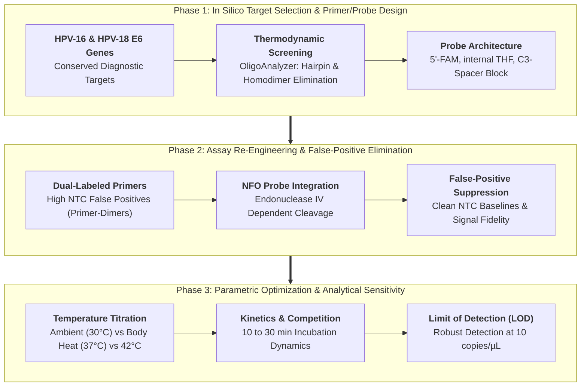
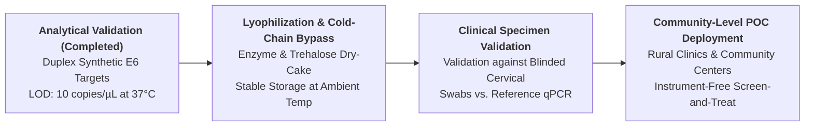

# Multienzyme Isothermal Rapid Amplification-coupled Lateral Flow Assay for Point-of-Care Cervical Cancer Diagnosis through High-Risk Human Papillomavirus Detection

**Author(s):** Md Abu Sadat Soash  
**Supervisor:** Prof. Dr. Gokul Chandra Biswas  
*Department of Genetic Engineering and Biotechnology*<br>
*Shahjalal University of Science and Technology, Sylhet, Bangladesh*

[](#8-authorship-confidentiality--inquiries)
[](#2-assay-architecture--detection-chemistry)
[](#2-assay-architecture--detection-chemistry)
[](#4-key-experimental-findings--assay-optimization)

---

## Abstract

* **Objective:** Cervical cancer is a leading cause of oncological mortality among women globally, with disproportionate morbidity in low- and middle-income countries (LMICs) such as Bangladesh. While the World Health Organization recommends molecular HPV DNA testing over subjective visual inspection with acetic acid (VIA), standard quantitative PCR (qPCR) is severely hindered by requirements for expensive thermal cyclers, uninterrupted electricity, cold-chain logistics, and specialized personnel. This study aims to engineer an equipment-free, point-of-care (POC) molecular diagnostic platform for the simultaneous duplex detection of high-risk human papillomavirus genotypes HPV-16 and HPV-18 E6 oncogenes.
* **Methodology:** The platform integrates Multienzyme Isothermal Rapid Amplification (MIRA) with a duplex Lateral Flow Dipstick (LFD). Conserved regions of the HPV-16 and HPV-18 E6 oncogenes were targeted. To eradicate false-positive signals generated by primer-dimer hybridization in early dual-labeled direct-primer configurations, the reaction was re-engineered around an unlabeled forward primer, a hapten-labeled reverse primer, and an internal fluorescein (FAM)-labeled probe containing a tetrahydrofuran (THF) abasic site cleaved sequence-specifically by *E. coli* Endonuclease IV (NFO). Band intensities across temperature gradients, reaction times, and template concentrations were quantified via optical densitometry.
* **Findings:** The optimized probe-mediated MIRA-LFD assay completely eliminated non-template control (NTC) false positives. At 37 °C (compatible with human body heat or simple non-electric heat pouches), the assay achieved an analytical limit of detection (LOD) of **10 copies/µL** for both HPV-16 and HPV-18 within **30 minutes**. Discernible bands developed within 10 minutes, and successful amplification occurred even at ambient room temperature (30 °C). Template competition profiling demonstrated robust dual-target resolution with zero cross-reactivity between HPV-16 and HPV-18 channels.
* **Implications:** This MIRA-LFD assay establishes an equipment-free, instrument-less molecular diagnostic platform for high-risk HPV screening in primary healthcare clinics, rural health centers, and resource-constrained field settings, providing an actionable tool to accelerate global cervical cancer elimination goals.

---

## 1. Clinical Background & Healthcare Challenge

Cervical carcinoma is primarily caused by persistent infection with high-risk human papillomaviruses, with **HPV-16 and HPV-18 accounting for over 70% of invasive cervical cancers globally**. In Bangladesh and comparable developing countries, national HPV vaccination programs face implementation hurdles, and screening predominantly relies on Visual Inspection with Acetic Acid (VIA), which suffers from high operator subjectivity, low sensitivity, and variable diagnostic accuracy.

```
                  Cervical Cancer Screening in LMICs
                                  │
                 ┌────────────────┴────────────────┐
                 ▼                                 ▼
   Visual Inspection with Acetic Acid       Standard Quantitative PCR
             (VIA Screening)                    (HPV DNA Testing)
                 │                                 │
                 ▼                                 ▼
   • Subjective visual scoring            • High analytical sensitivity
   • High false-negative rates            • Requires expensive thermal cycler
   • Misses non-visible lesions           • Demands continuous electricity
   • Variable inter-observer accuracy     • Needs centralized laboratory
                 │                                 │
                 └────────────────┬────────────────┘
                                  ▼
                Unmet Need: Equipment-Free Molecular POC
                                  │
                                  ▼
           Duplex MIRA-LFD Assay (HPV-16 & HPV-18 E6)
           • Isothermal (37°C body heat / 30 min)
           • Visual lateral flow readout (T1: 16, T2: 18, C)
           • Zero electrical equipment / field deployable
```

1. **The Infrastructure Gap:** Gold-standard qPCR requires high-precision Peltier thermal cyclers and real-time optical fluorescence detectors. Such instrumentation is restricted to centralized tertiary hospital laboratories in major metropolitan centers, excluding rural and marginalized populations.
2. **The Primer-Dimer Pitfall in Isothermal Lateral Flow:** Standard recombinase-based isothermal assays frequently generate dual-labeled primer-dimers during room-temperature setup. When coupled with lateral flow strips, these non-specific amplicons bridge colloidal gold and capture lines, causing catastrophic false-positive test bands in healthy patients.
3. **Study Aims:** This research resolves the primer-dimer artifact via an internal Endonuclease IV-cleaved probe and establishes optimized temperature, time, and copy-number parameters for equipment-free high-risk HPV screening.

---

## 2. Assay Architecture & Detection Chemistry

```
                        [ Target DNA: HPV E6 Oncogene ]
                                       │
            ┌──────────────────────────┴──────────────────────────┐
            ▼                                                     ▼
[ Recombinase-Mediated Strand Invasion ]             [ Annealing of Internal NFO Probe ]
  • RecA-family recombinase + SSBs                     • 5'-FAM label & C3 spacer block
  • Unlabeled Forward Primer                           • Central abasic THF site
            │                                                     │
            ▼                                                     ▼
[ Strand-Displacing DNA Polymerase ]                 [ Sequence-Specific Endo IV Cleavage ]
  • Exponential isothermal synthesis                   • Cleaves THF strictly on duplex
  • Incorporates 5'-Biotin/DIG reverse primer          • Releases functional 3'-OH for extension
            │                                                     │
            └──────────────────────────┬──────────────────────────┘
                                       ▼
                       [ Dual-Labeled Target Amplicons ]
                     • HPV-16: FAM + Biotin Dual Label
                     • HPV-18: FAM + Digoxigenin Dual Label
                                       │
                                       ▼
                     [ Duplex Lateral Flow Dipstick (LFD) ]
                     ├── Conjugate Pad: Anti-FAM Colloidal Gold (AuNPs)
                     ├── Test Line 1 (T1): Streptavidin (Captures HPV-16)
                     ├── Test Line 2 (T2): Anti-DIG Antibody (Captures HPV-18)
                     └── Control Line (C): Quality / Liquid Flow Verification
```

### 2.1 Reagent Formulation & Lateral Flow Strip Assembly

| Strip Component | Physical Matrix | Biological / Chemical Functionalization | Target Capture Role |
| :--- | :--- | :--- | :--- |
| **Sample Pad** | Cellulose fiber membrane | Buffered physiological wetting agent | Promotes uniform fluid uptake and sample wicking |
| **Conjugate Pad** | Glass fiber membrane | Anti-FAM antibody-conjugated colloidal gold (AuNPs) | Binds 5'-FAM label on all cleaved target amplicons |
| **Test Line 1 (T1)** | Nitrocellulose membrane | Immobilized Streptavidin ($1.0\ \text{mg/mL}$) | Captures Biotin-labeled HPV-16 amplicons |
| **Test Line 2 (T2)** | Nitrocellulose membrane | Immobilized Anti-Digoxigenin antibody ($1.0\ \text{mg/mL}$) | Captures DIG-labeled HPV-18 amplicons |
| **Control Line (C)** | Nitrocellulose membrane | Immobilized Anti-Mouse secondary IgG | Captures unbound gold-conjugate to verify valid test flow |

---

## 3. Computational & Experimental Pipeline Architecture



---

## 4. Key Experimental Findings & Assay Optimization

### 4.1 Resolution of Primer-Dimer Artifacts via NFO Probe Cleavage

The initial dual-labeled primer design yielded persistent, non-specific test bands on no-template controls (NTC), compromising assay specificity. Transitioning to an internal Endonuclease IV-dependent probe format resolved this artifact completely:

| Configuration | Forward Primer | Reverse Primer | Internal Probe | NTC Signal | Specificity Outcome |
| :--- | :---: | :---: | :---: | :---: | :--- |
| **Initial Dual-Primer** | 5'-FAM Labeled | 5'-Biotin / DIG | None | **Intense False Positive** | Failed; primer-dimers bridge gold nanoparticles to capture lines |
| **Optimized NFO Probe** | Unlabeled | 5'-Biotin / DIG | 5'-FAM, THF, 3'-C3 blocker | **Zero Band (Clean)** | **100% Specificity**; cleavage requires bona fide target duplex |

### 4.2 Operating Temperature Dynamics & Body-Heat Incubation

Reaction efficiency was systematically evaluated across ambient, physiological, and elevated temperatures:

| Reaction Temperature | Operating Condition | Visual Band Intensity (T1/T2) | Applicability in Low-Resource Settings |
| :---: | :--- | :---: | :--- |
| **30 °C** | Ambient room temperature | Faint yet visually detectable bands | Usable in warm climate field conditions; non-amplified readout |
| **37 °C** | **Body heat / Simple incubator** | **Intense, unambiguous sharp bands** | **Optimal field condition; can utilize body warmth or pocket heating** |
| **42 °C** | Laboratory reference condition | Maximum optical density | Benchmark for high-throughput clinic settings |

### 4.3 Incubation Kinetics & Template Dynamic Range

* **Kinetics of Signal Development:** Target line development was visually discernible within **10 minutes**, reaching maximum diagnostic contrast and line definition at **30 minutes**.
* **Analytical Sensitivity (LOD):**
  * At **1 copy/µL**, detection was positive but subject to stochastic Poisson distribution effects across replicates.
  * At **10 copies/µL**, both HPV-16 and HPV-18 produced intense, steady, and 100% reproducible test lines.
* **Duplex Channel Competition:** Increasing template concentration to 100 copies/µL demonstrated slight kinetics dominance by the HPV-18 channel due to shared dNTP/enzyme pools, without impairing simultaneous positive visual calls.

---

## 5. Visual Highlights & Experimental Gallery

| Figure | Description | Experimental Preview |
| :---: | :--- | :---: |
| **1** | **MIRA Isothermal Amplification Mechanism**<br/>Cascade of recombinase, single-stranded binding proteins, and strand-displacing polymerase. | [](results/1.3.jpg) |
| **2** | **Lateral Flow Assay Architecture**<br/>Spatial arrangement of sample pad, conjugate pad, nitrocellulose test lines (T1, T2), and control line. | [](results/1.4.png) |
| **3** | **Dual-Label NFO Probe Mechanism**<br/>Sequence-specific cleavage of internal THF site by Endonuclease IV on target duplex amplicons. | [](results/1.5.png) |
| **4** | **Experimental Study Workflow**<br/>Multi-phase progression from in silico oligo design to parametric optimization and sensitivity testing. | [](results/2.1.png) |
| **5** | **Elimination of Primer-Dimer False Positives**<br/>Direct comparison showing persistent NTC bands in dual-primer format vs. clean negative in probe format. | [](results/3.1.png) |
| **6** | **Temperature Optimization (30 °C, 37 °C, 42 °C)**<br/>Influence of reaction temperature on duplex line density confirming robust body-heat performance. | [](results/3.2.png) |
| **7** | **Incubation Time Series (10, 20, 30 min)**<br/>Time-course kinetics showing early emergence of test signals within 10–20 minutes. | [](results/3.3.png) |
| **8** | **Analytical Sensitivity Across Copy Numbers**<br/>Detection limits from 1 copy/µL to 100 copies/µL establishing robust 10 copies/µL LOD. | [](results/3.4.png) |

---

## 6. Repository Organization

```text
multienzyme-isothermal-hpv-detection/
├── results/                     # High-resolution experimental figures & schematics
│   ├── 1.3.jpg                  # Figure 1: MIRA isothermal amplification principle
│   ├── 1.4.png                  # Figure 2: LFD device structure schematic
│   ├── 1.5.png                  # Figure 3: Probe-mediated dual-label mechanism
│   ├── 2.1.png                  # Figure 4: Experimental workflow schematic
│   ├── 3.1.png                  # Figure 5: Primer-dimer elimination validation
│   ├── 3.2.png                  # Figure 6: Reaction temperature characterization
│   ├── 3.3.png                  # Figure 7: Incubation time series
│   └── 3.4.png                  # Figure 8: Analytical sensitivity and copy number analysis
├── Thesis_Revision_Final.docx   # Master thesis manuscript draft
├── .gitignore                   # Git configuration
└── README.md                    # Master research documentation
```

---

## 7. Translational Roadmap & Clinical Validation Pathway



1. **Reagent Lyophilization:** Formulate MIRA enzyme cascades and lyophilized reaction pellets with excipients (trehalose, dextran) to bypass cold-chain storage entirely.
2. **Simplified Sample Preparation:** Couple lateral flow detection with an equipment-free, boiling/lysis-based crude DNA extraction protocol for cervical swabs, eliminating commercial spin-column kits.
3. **Blinded Clinical Cohort Testing:** Validate analytical sensitivity and diagnostic specificity against standard clinical cervical swab cohorts in Bangladesh benchmarked against Roche Cobas / GeneXpert reference assays.

---

## 8. Authorship, Confidentiality & Inquiries

### Academic Leadership & Authorship
- **Author:** **Md Abu Sadat Soash**  
  *Department of Genetic Engineering and Biotechnology, Shahjalal University of Science and Technology, Sylhet, Bangladesh*  
  *Email:* [mdabu13@student.sust.edu](mailto:mdabu13@student.sust.edu)
- **Project Supervisor:** **Prof. Dr. Gokul Chandra Biswas**  
  *Professor, Department of Genetic Engineering and Biotechnology, Shahjalal University of Science and Technology, Sylhet, Bangladesh*

### Confidentiality & Publication Notice
This research documents original, unpublished experimental diagnostic methodology.
* All data, figures, and protocols are presented for academic review, evaluation, and repository archival.
* **Do not reproduce, distribute, or publicly cite** without explicit written authorization from the authors and research supervisors.
* For collaboration inquiries, contact: `mdabu13@student.sust.edu`.

---

## 9. References & Data Sources

1. **World Health Organization (2021).** *WHO guideline for screening and treatment of cervical pre-cancer lesions for cervical cancer prevention*, Second edition.
2. **Piepenburg, O., et al. (2006).** DNA detection using recombination proteins. *PLoS Biology*, 4(7), e204.
3. **Clifford, G. M., et al. (2003).** Human papillomavirus types in invasive cervical cancer worldwide: a meta-analysis. *British Journal of Cancer*, 88(1), 63–73.
4. **Lobato, I. M., & O'Sullivan, C. K. (2018).** Recombinase polymerase amplification: Basics, applications and recent advances. *TrAC Trends in Analytical Chemistry*, 98, 19–35.
5. **Arora, R., et al. (2020).** Lateral flow assays for point-of-care cervical cancer screening: Current progress and future prospects. *Biosensors and Bioelectronics*, 165, 112390.
