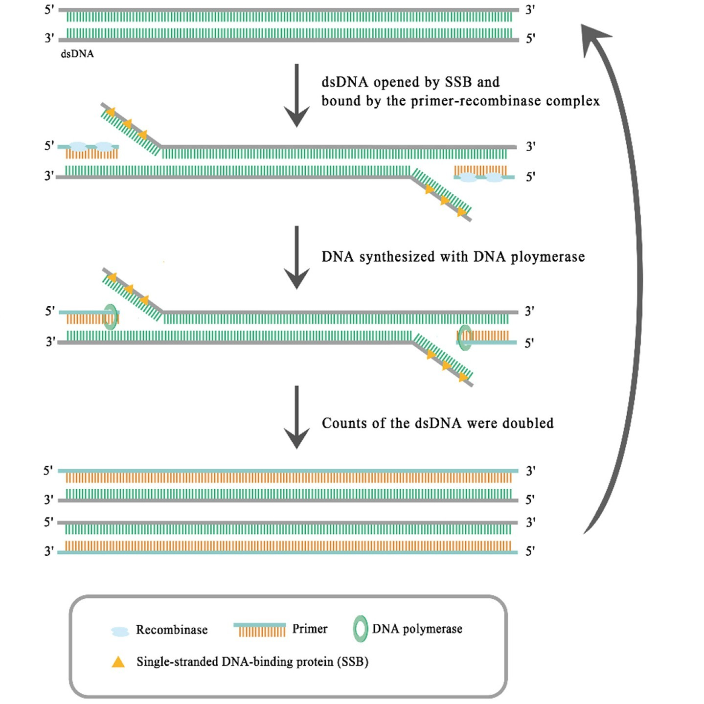
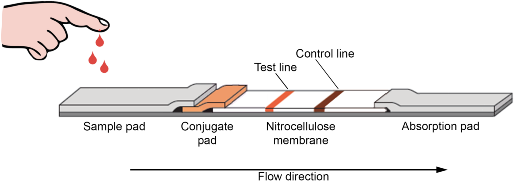
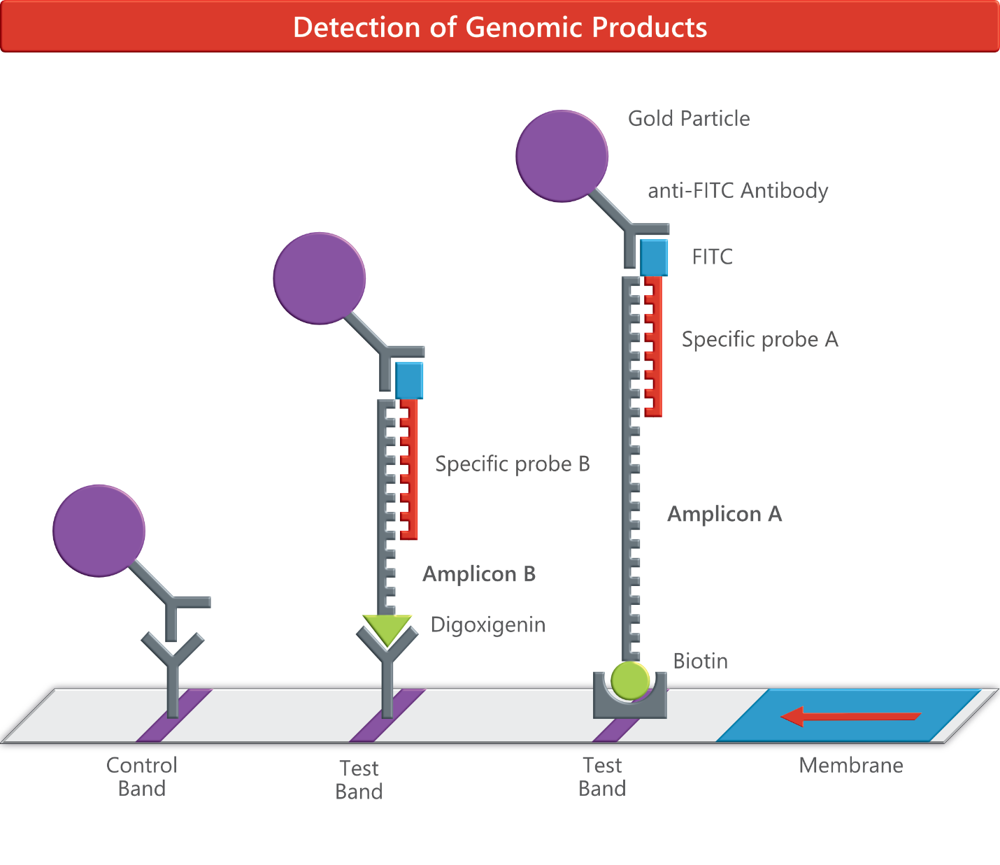
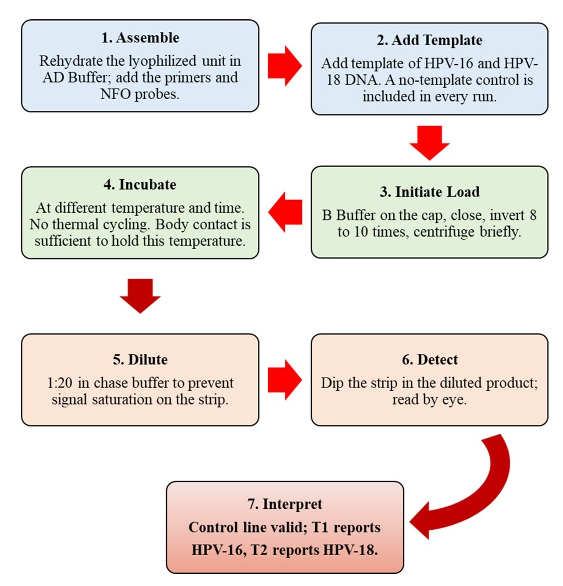
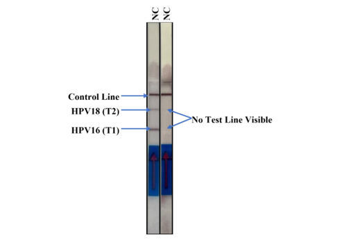
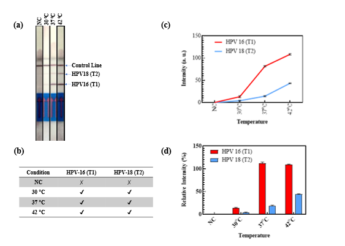
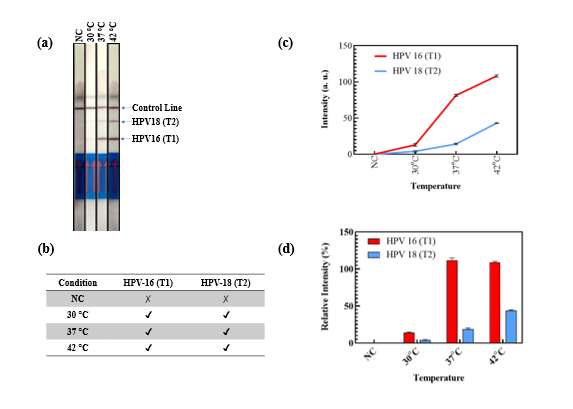
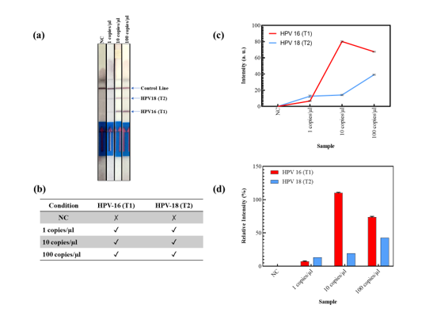

# Multienzyme Isothermal Rapid Amplification-coupled Lateral Flow Assay (MIRA-LFD) for Point-of-Care High-Risk HPV Detection

[](#confidentiality--publication-notice)
[](#assay-architecture--principle)
[](#overview)

> **Notice:** This repository contains codebase documentation, analytical workflows, and experimental summaries related to an undergraduate thesis project at the Department of Genetic Engineering and Biotechnology, Shahjalal University of Science and Technology, Sylhet, Bangladesh. The work is currently unpublished. Specific molecular sequences and proprietary formulation parameters have been withheld to preserve publication integrity.

---

## Overview

Cervical cancer is a leading cause of cancer mortality among women worldwide, disproportionately impacting low- and middle-income countries (LMICs) such as Bangladesh. While high-risk Human Papillomavirus (hrHPV)—predominantly genotypes **HPV-16** and **HPV-18**—drives the vast majority of cervical malignancies, current screening relies largely on visual inspection with acetic acid (VIA) or standard laboratory-bound quantitative PCR (qPCR). 

qPCR-based molecular diagnostics, though accurate, require sophisticated thermal cyclers, uninterrupted electrical power, cold-chain logistics, and specialized personnel. 

This project demonstrates an **equipment-free, instrument-less molecular diagnostic platform** coupling **Multienzyme Isothermal Rapid Amplification (MIRA)** with a **duplex lateral flow dipstick (LFD)** targeting the **E6 oncogene** of HPV-16 and HPV-18 for point-of-care (PoC) cervical cancer screening.

---

## Key Features

- **Isothermal Amplification:** Operates at constant temperature (~37 °C, compatible with body heat incubation), eliminating the need for thermal cyclers.
- **Duplex Visual Readout:** Distinguishes HPV-16 and HPV-18 simultaneously on a single test strip using gold nanoparticle (AuNP) immunochromatography.
- **Probe-Mediated Specificity:** Utilizes an endonuclease-cleavable internal NFO probe design to eliminate primer-dimer artifacts and false-positive test lines.
- **Rapid Turnaround:** Delivers unambiguous, visually readable diagnostic endpoints within **30 minutes**.
- **Field Deployability:** Aligns with WHO ASSURED criteria for decentralized, low-resource primary care clinics and community screening.

---

## Assay Architecture & Principle

```
                        [ Target DNA (E6) ]
                                 │
           ┌─────────────────────┴─────────────────────┐
           ▼                                           ▼
[ Recombinase-Assisted Annealing ]             [ Probe Cleavage (Endo IV) ]
           │                                           │
           ▼                                           ▼
[ Strand-Displacing Polymerase ]               [ Dual-Label Amplicon Formed ]
           │                                           │
           └─────────────────────┬─────────────────────┘
                                 │
                                 ▼
              [ Lateral Flow Dipstick Detection (LFD) ]
              ├── Test Line 1 (T1): HPV-16 (Biotin-Streptavidin)
              ├── Test Line 2 (T2): HPV-18 (DIG-Anti-DIG)
              └── Control Line (C): Quality / Flow Verification
```

### 1. Isothermal Enzymatic Amplification (MIRA)
MIRA utilizes a three-enzyme cascade operating at near-physiological temperatures (37 °C–42 °C). A recombinase–primer nucleoprotein filament mediates strand invasion without thermal denaturation, single-stranded binding proteins (SSBs) stabilize the open displacement loop, and a strand-displacing DNA polymerase drives rapid, exponential target amplification.


*Figure 1: Mechanism of Multienzyme Isothermal Rapid Amplification (MIRA).*

### 2. Duplex Lateral Flow Detection (LFD)
The amplification product is introduced to a paper-based lateral flow dipstick. Conjugated anti-FAM gold nanoparticles migrate across the membrane via capillary force. To prevent dual-labeled primer-dimers from yielding non-template false positives, the assay employs an internal NFO probe cleaved sequence-specifically by Endonuclease IV, ensuring that dual-label capture occurs strictly in the presence of bona fide target amplicons.

| Component | Function / Capture Target |
|:---|:---|
| **Conjugate Pad** | Anti-FAM colloidal gold nanoparticles (AuNPs) |
| **Test Line 1 (T1)** | Immobilized Streptavidin (captures Biotin-labeled HPV-16 amplicon) |
| **Test Line 2 (T2)** | Immobilized Anti-DIG antibody (captures Digoxigenin-labeled HPV-18 amplicon) |
| **Control Line (C)** | Quality control capture verifying uniform capillary migration |


*Figure 2: Lateral flow assay architecture.*


*Figure 3: Probe-mediated dual-label lateral flow strip mechanism.*

---

## Study Workflow

The complete analytical and experimental progression follows a multi-phase validation pipeline:


*Figure 4: Schematic representation of the study workflow.*

1. **Target Selection & In Silico Design:** Conserved diagnostic regions within the HPV-16 and HPV-18 E6 oncogenes were mapped, modeled, and selected to avoid target-target dimerization.
2. **Architecture Optimization:** Transition from direct primer labeling to an internal probe-mediated format to suppress non-specific background signals.
3. **Parametric Optimization:** Systematically evaluated reaction temperatures (ambient ~30 °C, physiological ~37 °C, and reference ~42 °C) and reaction times (10 to 30 min).
4. **Analytical Sensitivity & Competition Profiling:** Evaluated limit of detection and duplex channel dynamics across template copy numbers.

---

## Experimental Highlights (Summary)

*(Note: High-level observations summarized below; extensive numerical datasets are withheld prior to peer-reviewed publication.)*

### 1. Elimination of Primer-Dimer Artefacts
Initial direct 5'-end primer dual-labeling resulted in spurious false-positive bands on negative controls (NTC) due to inter-primer hybridization. Redesigning the reaction around an internal nfo-probe architecture completely abolished false-positive test lines while maintaining robust positive control responses.


*Figure 5: Probe-mediated suppression of primer-dimer false positives in negative controls.*

### 2. Operational Temperature Tolerance
- **37 °C (Body Temperature):** Generates clear, visually discernible test bands for both HPV-16 and HPV-18 within 30 minutes, confirming that body-heat incubation is viable for equipment-free deployment.
- **30 °C (Ambient Condition):** Detectable yet marginal visual bands, demonstrating enzymatic activity at room temperature, though physiological warming is recommended for robust field scoring.
- **42 °C (Reference Condition):** Serves as an upper reference benchmark confirming maximum enzymatic yield.


*Figure 6: Influence of reaction temperature on duplex MIRA-LFD performance.*

### 3. Incubation Kinetics & Duplex Dynamics
- Target line development begins within 10 minutes, reaching optimal signal differentiation and balance at **30 minutes**.
- Competitive kinetics between HPV-16 and HPV-18 amplification channels reveal shared enzyme pool utilization during late exponential phases.

| Incubation Time | Analytical Sensitivity |
|:---:|:---:|
|  |  |
| *Figure 7: Time-dependent line development (10–30 min).* | *Figure 8: Analytical sensitivity across copy number inputs.* |

---

## Repository Structure

```text
multienzyme-isothermal-hpv-detection/
├── results/                     # Experimental figures and schematic diagrams
│   ├── 1.3.jpg                  # MIRA isothermal amplification principle
│   ├── 1.4.png                  # LFD device structure schematic
│   ├── 1.5.png                  # Probe-mediated dual-label mechanism
│   ├── 2.1.png                  # Experimental workflow
│   ├── 3.1.png                  # Primer-dimer elimination validation
│   ├── 3.2.png                  # Reaction temperature characterization
│   ├── 3.3.png                  # Incubation time series
│   └── 3.4.png                  # Analytical sensitivity and copy number analysis
├── Thesis_Revision_Final.docx   # Master thesis document
├── .gitignore                   # Git configuration
└── README.md                    # Project documentation
```

---

## Confidentiality & Publication Notice

This research contains original, currently **unpublished experimental findings and methodology**.
- All data, figures, and technical descriptions are for evaluation, review, and archival purposes within this repository.
- **Do not reproduce, distribute, or publicly cite** without explicit written authorization from the authors and research supervisors.
- For academic collaboration or inquiry regarding the manuscript and dataset, please contact the corresponding laboratory:

**Department of Genetic Engineering and Biotechnology**  
Shahjalal University of Science and Technology (SUST)  
Sylhet-3114, Bangladesh
